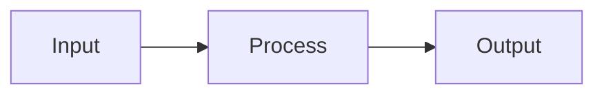

<p align="center">
  
</p>

<h1 align="center">MarkStack</h1>

<p align="center">
  <strong>A lightweight static site generator for markdown-based knowledge bases and documentation.</strong>
</p>

<p align="center">
  Transform your markdown files into a searchable, professional documentation website with minimal resource overhead.
</p>

<p align="center">
  <a href="#features">Features</a> |
  <a href="#use-cases">Use Cases</a> |
  <a href="#quick-start">Quick Start</a> |
  <a href="#documentation">Documentation</a> |
  <a href="#deployment">Deployment</a> |
  <a href="#license">License</a>
</p>

<p align="center">
  
  
  
  
</p>

---

## Design Philosophy

MarkStack is built on a simple premise: **Documentation should be accessible, robust, and permanent.** It is designed to serve all walks of life, from the student building a second brain, to the Dungeon Master organizing a campaign, to the Enterprise Architect enforcing ISO compliance.

**Built for the "Potato" & the Cloud**
I intentionally developed MarkStack on a single-core, 1GB RAM virtual machine. Why? Because if it runs there, it runs *anywhere*.
* **For the Hobbyist:** Run it on a Raspberry Pi Zero 2 W, an old laptop, or a free cloud tier. It respects your hardware.
* **For the Enterprise:** It scales effortlessly in high-availability clusters with zero resource bloat.

**Radical Simplicity: Vanilla by Design**
Modern web development has become over-complicated. MarkStack rejects this. MarkStack is built with **Vanilla JavaScript** and a single file build process. There is no complex architecture to learn, no "magic" black-box frameworks, and no fragility.
* **Hackable:** Because the code is simple and transparent, you can read it, understand it, and modify it to fit your exact needs.
* **Future-Proof:** With no heavy dependencies, your documentation site won't break just because an npm package updated 5 years from now.

**Enterprise Grade: Compliance & Audit**
In professional environments, documentation is a legal record. MarkStack solves "documentation rot" by treating your docs *as code*.
* **The Audit Trail:** You get an immutable Git history for every comma changed. Strict Pull Request workflows mean nothing goes live without approval. This is perfect for ISO record-keeping.
* **Accountability:** No more "mystery edits." You know exactly who wrote that API guide, who approved it, and when it went live.

**The "Headless" Brain: From D&D to Ph.D.**
You don't need to be a systems engineer to have a powerful, globally accessible knowledge base. MarkStack turns GitHub (or any private Git repo) into your personal Content Management System.
* **The Workflow:** Creating a study guide for a new subject? Managing lore for your D&D campaign? Just edit your files in the browser on GitHub (even on mobile!) and your site updates automatically if you setup the workflow, or if you have a site you use Cloudflare Pages or GitHub Pages with, it updated with each update to the repo!
* **The Freedom:** You get the ease of a note-taking app with the power of a static site. Your data remains yours. It is private, portable, and secure, stored in simple Markdown files that you will always own.

**OFF LINE MODE!**
* **Take it with you:** You can just clone the repo, build your first few pages and copy it to a USB, take it with you and use any text editor on any computer to edit the .md files! I REALLY recommend Caddy, it has a portable version for every OS, be it MacOS or Linux or Windows so basically all you have to do is just copy the the executable / binary to the dist folder and run it after you ran the script to build your files.
You can find it here: [Caddy Offical Repo](https://github.com/caddyserver/caddy/releases)

---

## Use Cases

MarkStack adapts to a wide range of documentation needs. The table below outlines common scenarios where teams and individuals have successfully deployed MarkStack-powered sites.

| Use Case | Description | Example |
|----------|-------------|---------|
| **Product Documentation** | Public-facing documentation for software products, APIs, or services. Supports versioning through Git branches and provides professional presentation for end users. | SaaS product help center, open source project documentation |
| **Internal Knowledge Base** | Centralized repository for company policies, procedures, and institutional knowledge. Searchable and accessible to all team members without external dependencies. | IT runbooks, HR policies, operational procedures |
| **Developer Handbook** | Onboarding resource for new developers joining a team. Documents codebase architecture, development workflows, coding standards, and deployment processes. | Engineering team onboarding, contributor guidelines |
| **API Reference** | Technical reference documentation with code examples, endpoint descriptions, and authentication guides. Syntax highlighting supports 190+ languages. | REST API documentation, SDK reference |
| **Personal Knowledge Base** | Private or public collection of notes, tutorials, and reference material. Ideal for developers maintaining their own technical notes. | Learning notes, technology comparisons, how-to guides |
| **Course Material** | Educational content with structured navigation, code examples, and progressive learning paths. Task lists enable progress tracking for students. | Programming tutorials, certification study guides |
| **Project Wiki** | Lightweight alternative to traditional wiki software. Version-controlled through Git with full change history and collaborative editing through pull requests. | Team project documentation, research notes |

---

## GitHub-Native Workflow

MarkStack uses standard GitHub-flavored Markdown for all content. This design decision enables a streamlined documentation workflow that integrates directly with your existing development process.

**How it works:**

1. Documentation lives alongside your code in the same repository
2. Edit any `.md` file directly in the GitHub web interface or your local editor
3. Commit and push changes through your normal Git workflow
4. Rebuild the site with a single command
5. All changes are tracked in Git history with full attribution

This approach eliminates the need for separate documentation platforms or content management systems. Your documentation benefits from the same review process, branching strategy, and collaboration tools you already use for code. Pull requests enable documentation reviews, and merge conflicts are resolved using familiar Git workflows.

```bash
# Update documentation from the latest changes
git pull origin main
npm run build

# Documentation is now current
```

---

## Features

### Content Authoring

- **Standard Markdown** with YAML frontmatter, compatible with GitHub rendering
- **GitHub-style alerts** for NOTE, TIP, IMPORTANT, WARNING, and CAUTION callouts
- **Task lists and footnotes** for checklists and academic-style references
- **Syntax highlighting** for 190+ programming languages via highlight.js
- **Mermaid diagrams** for flowcharts, sequence diagrams, and other visualizations
- **Visual editor** with live preview, scroll sync, and file management

### User Experience

- **Dark and light themes** with automatic preference persistence
- **IBM Plex typography** for professional, readable text
- **Responsive layout** that adapts to desktop, tablet, and mobile screens
- **Collapsible sidebar** with hierarchical navigation

### Performance

- **Fast builds** averaging 1.0 to 1.4 seconds for sites with 50+ content-heavy pages
- **Single-file architecture** with no build toolchain complexity
- **Zero client-side frameworks** using only vanilla JavaScript
- **Static HTML output** requiring no application server

### Search

- **Full-text client-side search** that works offline. The build writes `search-index.json` with one entry per page and one per heading (h2 to h4), so a result can open the page at the matching heading. No search server.
- **One search window.** Press `Ctrl+K` (or `Cmd+K`, or `/`) or click the search box. Results are grouped into Pages and Sections with the folder path shown. Arrow keys move, Enter opens the selected result, Esc closes.
- **Forgiving matching.** Partial words match, all typed words must match, small typos are tolerated for words of five or more letters, and `"quoted phrases"` must match exactly.
- **Context highlighting** showing matches within search results. The matching code is in `static/js/search-core.js` and is covered by tests.

---

## Quick Start

```bash
# Clone the repository
git clone https://github.com/KineticEnforcer/MarkStack.git
cd MarkStack

# Install dependencies
npm ci

# Build the site
npm run build

# Preview locally
npm run serve
```

Open http://localhost:3000 in your browser. Your documentation site is ready for content.

---

## Documentation

MarkStack includes comprehensive documentation covering all aspects of the system:

| Section | Description |
|---------|-------------|
| [Getting Started](content/getting-started/) | Installation requirements, quickstart guide, project structure overview |
| [Authoring Content](content/authoring/) | Markdown features, frontmatter schema, content organization patterns |
| [Configuration](content/configuration/) | Site settings, homepage customization, metadata options |
| [Customization](content/customization/) | Theme variables, CSS customization, template modification |
| [Build and Deploy](content/build-deploy/) | CLI commands, CI/CD integration, hosting platform setup |
| [Architecture](content/architecture/) | Build pipeline internals, navigation generation, search indexing |
| [Troubleshooting](content/troubleshooting/) | Common issues with solutions, frequently asked questions |

---

## Project Structure

```
markstack/
├── build.js              # Build script (single-file static site generator)
├── editor-server.js      # Visual editor server
├── editor.html           # Visual editor interface
├── login.html            # Editor sign-in page
├── admin-users.html      # Editor user management page
├── lib/                  # Editor auth, sessions, section rules
├── scripts/              # create-admin command
├── siteconfig.json       # Site configuration
├── content/              # Markdown content directory
│   ├── _index.md         # Homepage content (optional)
│   └── category/         # Category folders
│       ├── _index.md     # Category landing page
│       └── article.md    # Individual articles
├── templates/
│   └── base.html         # HTML template with placeholders
├── static/               # Static assets copied to output
│   ├── css/              # Stylesheets
│   ├── js/               # Client-side JavaScript
│   └── svg/              # Logo and icons
└── dist/                 # Generated output (excluded from version control)
```

---

## Configuration

Edit `siteconfig.json` to customize your site:

```json
{
  "siteTitle": "My Knowledge Base",
  "headerTitle": "MyKB",
  "siteSubtitle": "Documentation for everything",
  "siteUrl": "https://docs.example.com",
  "baseUrl": "",
  "defaultDescription": "Knowledge base and documentation",
  "showHero": true,
  "copyrightText": "© 2026 Your Name"
}
```

| Property | Description |
|----------|-------------|
| `siteTitle` | Full site title used in browser tabs and metadata |
| `headerTitle` | Shorter title displayed in the site header |
| `siteSubtitle` | Tagline displayed on the homepage hero section |
| `siteUrl` | Base URL for canonical links and Open Graph metadata |
| `baseUrl` | Path prefix for all internal links (see table below) |
| `defaultDescription` | Fallback description for pages without frontmatter |
| `showHero` | Toggle homepage hero section visibility |
| `copyrightText` | Footer copyright notice |
| `allowRawHtml` | Optional. Raw HTML inside Markdown (tags such as `<div>`, `<iframe>`, `<script>`) is shown as plain text unless this is the boolean `true`. Default is off. Only set it for sites where everyone who can edit content is fully trusted: raw HTML is copied unchanged into the public pages. The setting lives in this file on the server; the editor cannot change it |

### Base URL Configuration

The `baseUrl` setting controls the path prefix for all internal links. Set it according to where your site is hosted:

| Hosting Location | `baseUrl` Value | Example URL |
|-----------------|-----------------|-------------|
| Root domain | `""` (empty string) | `https://docs.example.com/` |
| Subdirectory | `"/docs"` | `https://example.com/docs/` |
| GitHub Pages (user site) | `""` | `https://username.github.io/` |
| GitHub Pages (project site) | `"/repo-name"` | `https://username.github.io/repo-name/` |

For most deployments, leave `baseUrl` empty. Only set it when hosting in a subdirectory or on a GitHub Pages project site.

---

## Writing Content

### Creating a Page

```bash
# Create a new article
echo "# My Article" > content/my-article.md
npm run build
```

### Creating a Category

```bash
# Create a category with a landing page
mkdir content/tutorials
cat > content/tutorials/_index.md << 'EOF'
---
title: Tutorials
description: Step-by-step guides for common tasks.
---
EOF

# Add an article to the category
echo "# Getting Started" > content/tutorials/getting-started.md
npm run build
```

### Frontmatter

Every page can include YAML frontmatter for metadata:

```yaml
---
title: Page Title
description: Description for search engines and social sharing.
---

Content begins here...
```

Page and category URLs come from the `title`, not the file or folder name. Two pages (or two categories) with the same title in the same place would produce the same URL, so the build stops with `Duplicate URL ... is produced by both ...` and names both content paths. Change one of the titles. A failed build leaves the previous `dist/` untouched.

### Alerts

Use GitHub-style alert syntax for callouts:

```markdown
> [!NOTE]
> Supplementary information the reader should know.

> [!TIP]
> Helpful advice for better results.

> [!IMPORTANT]
> Critical information for successful outcomes.

> [!WARNING]
> Potential issues the reader should be aware of.

> [!CAUTION]
> Risk of negative consequences from specific actions.
```

### Diagrams

Create diagrams using Mermaid syntax:

~~~markdown

~~~

---

## Commands

| Command | Description |
|---------|-------------|
| `npm run build` | Generate static site to the `dist/` directory |
| `npm run watch` | Rebuild automatically when content files change |
| `npm run editor` | Launch the visual markdown editor with live preview (sign-in required) |
| `npm run editor:create-admin -- --user NAME` | Create an editor administrator (password at a hidden prompt) |
| `npm run serve` | Start a local preview server on port 3000 |
| `npm run clean` | Remove the `dist/` directory |

**Development workflow:**

```bash
# Terminal 1: Watch for changes and rebuild
npm run watch

# Terminal 2: Serve the site locally
npm run serve

# Or use the visual editor for focused writing
npm run editor
```

---

## Deployment

MarkStack generates static HTML files that can be hosted on any web server or static hosting platform.

| Platform | Configuration |
|----------|---------------|
| **Cloudflare Pages** | Connect repository. Build command: `npm run build`. Output directory: `dist` |
| **GitHub Pages** | Push contents of `dist/` to a `gh-pages` branch or configure Actions workflow |
| **Netlify** | Connect repository. Build command: `npm run build`. Publish directory: `dist` |
| **Vercel** | Connect repository. Framework preset: Other. Output directory: `dist` |
| **AWS S3** | Upload contents of `dist/` to an S3 bucket configured for static hosting |
| **Self-hosted** | Copy contents of `dist/` to your web server document root |

For automated deployments, see the [CI/CD Integration](content/build-deploy/ci-cd.md) documentation.

---

## Technology

| Component | Implementation |
|-----------|----------------|
| Markdown Processing | [markdown-it](https://github.com/markdown-it/markdown-it) with anchor, footnote, and task list plugins |
| Frontmatter Parsing | [gray-matter](https://github.com/jonschlinkert/gray-matter) for splitting, [js-yaml](https://github.com/nodeca/js-yaml) for YAML (YAML only, see `lib/frontmatter.js`) |
| Syntax Highlighting | [highlight.js](https://highlightjs.org/) supporting 190+ languages |
| Diagram Rendering | [Mermaid](https://mermaid.js.org/) for flowcharts and diagrams |
| File Watching | [chokidar](https://github.com/paulmillr/chokidar) for development mode |
| Frontend | Vanilla JavaScript with no framework dependencies |
| Typography | IBM Plex Sans and IBM Plex Mono |

---

## Requirements

- Node.js 24 or higher (current LTS)
- npm (included with Node.js)

No additional build tools, compilers, or system dependencies are required.

---

## Changelog

### Version 1.1.4 (January 2026)

This release introduces the Visual Editor and significantly improves code quality across the codebase.

#### New Features

- **Visual Editor** (`npm run editor`)
  - Browser-based markdown editor with live preview
  - File tree panel for navigating and managing content
  - Real-time preview styled exactly like the built site
  - Scroll synchronization between editor and preview panels
  - File management: create, rename, delete files and folders
  - Keyboard shortcuts: Ctrl+S (save), Ctrl+B (build)
  - Confirmation modals for unsaved changes and destructive actions

#### Improvements

- **Code Quality Refactoring**
  - Added comprehensive JSDoc documentation to all source files
  - Organized code with clear section separators and comments
  - Improved function naming and code structure
  - Professional-grade documentation following senior developer standards

- **Editor Server** (`editor-server.js`)
  - RESTful API for file operations (read, write, create, delete, rename)
  - File tree endpoint for content navigation
  - Build trigger endpoint for site regeneration
  - Secure local-only access on port 3001

- **Editor Interface** (`editor.html`)
  - Split-panel layout with resizable sections
  - Syntax highlighting for markdown editing
  - GitHub-style alert rendering in preview
  - Mermaid diagram support in preview
  - Unsaved changes detection with visual indicator

#### Documentation

- New [Visual Editor](/authoring/visual-editor/) documentation page
- Updated [Commands Reference](/build-deploy/commands/) with editor command
- Updated [Project Structure](/getting-started/project-structure/) with editor files
- Updated [Quickstart](/getting-started/quickstart/) with editor workflow

---

### Editor security

The visual editor (`npm run editor`) requires sign-in. Accounts are stored in `.markstack/users.json` (owner-only, git-ignored; `MARKSTACK_USERS_FILE` changes the path).

- Create the first administrator on the server with `npm run editor:create-admin -- --user NAME`. The password is typed at a hidden prompt (or piped on standard input for scripts). It is never a command line argument and is never logged.
- Locked-out administrator: on the server run `npm run editor:reset-admin -- --user NAME`. Same hidden prompt, nothing in the command line or the logs; it also re-enables a disabled account. It needs shell access to the server, which already means access to the user file. The running editor picks the change up on its next request: the old password stops working, the new one works, and sessions open for that account end, with no restart. Every change to the user file (the commands and the editor) takes a lock file next to it (`users.json.lock`), reads the current file, applies the change and writes it atomically, so changes made at the same time from different processes all survive. If the lock cannot be taken within 5 seconds the change fails with an error and nothing is written; a lock left by a process that no longer exists is taken over after 30 seconds. If the user file cannot be read, changes stop with an error instead of overwriting it. The lock is advisory: it covers MarkStack's own commands and editor, not another program that edits the file by hand.
- Administrators manage accounts at `/admin/users` in the editor: add users, assign editors to sections, disable accounts and reset editor passwords. A reset shows a one-time temporary password once; the editor must choose a new password at the next sign-in and their open sessions end.
- A section is a top-level folder of `content/`. An editor sees and edits only the sections assigned to them; anything else answers as "not found". Editors cannot create top-level folders or rename or delete a section folder. Administrators can edit everything. There is no build button or build endpoint; publishing is a build run by whoever runs the site build.
- Passwords are hashed with scrypt (Node built-in) with a per-user salt, at least 12 characters, no composition rules. Sessions use a random token in an `HttpOnly`, `SameSite=Strict` cookie; only a hash of the token is kept in memory, so restarting the editor signs everyone out. Every change request needs a CSRF token header. After 5 failed sign-ins for the same account from the same address, that address is paused for that account for 15 minutes; 30 failures from one address pause all sign-ins from it. Someone guessing from one address therefore cannot lock the real user out from another. Guessing spread over many addresses is limited per account: after 20 failures in 15 minutes, addresses that account has never signed in from are paused for it, while the addresses it has signed in from (last 5, kept in memory) keep working. A person on a new address during such an attack has to wait for the pause to end.
- Session limits default to 8 hours idle and 7 days total (`MARKSTACK_SESSION_IDLE_MINUTES`, `MARKSTACK_SESSION_MAX_MINUTES`). Set `MARKSTACK_EDITOR_COOKIE_SECURE=1` when the editor is served over HTTPS: the cookie is then marked `Secure` and named `__Host-ms_session`, which the browser accepts only with `Secure`, `Path=/` and no `Domain`, so a sibling subdomain cannot plant or overwrite it. Browsers reject that prefix on plain HTTP, so without the setting (local use) the cookie is named `ms_session`. Logout and sign-in over HTTPS also expire any old `ms_session` cookie. Existing sessions end when you switch the setting on, so users sign in again.
- Behind a reverse proxy, set `MARKSTACK_TRUSTED_PROXIES` to the proxy's address (for example `127.0.0.1`, or `loopback`; comma separated). The client address is read from `X-Forwarded-For` only when the connection itself comes from one of those addresses, taking the first entry from the right that is not one of your proxies. Without it (default) the header is ignored and every visitor behind the proxy shares the proxy's address, so enable it for nginx. Your proxy must append the real client address, for example `proxy_set_header X-Forwarded-For $proxy_add_x_forwarded_for;`.
- Two-factor sign-in is not included.

Other protections:

- It binds to `127.0.0.1` by default. Set `MARKSTACK_EDITOR_HOST` to change this, and add the public host name to `MARKSTACK_EDITOR_ALLOWED_HOSTS` (comma separated) or requests are refused. Serve it over HTTPS behind a reverse proxy if you expose it.
- `MARKSTACK_EDITOR_PORT` changes the port (default 3001). `MARKSTACK_EDITOR_MAX_BODY` sets the largest request body in bytes (default 2 MiB).
- Requests need a known `Host`, a matching `Origin` when one is sent, and `Content-Type: application/json` for writes. The content root cannot be deleted or renamed and paths cannot leave `content/` (symlinks included).
- The live preview renders inside a sandboxed iframe (no scripts) with a restrictive Content-Security-Policy, so raw HTML or Mermaid blocks in a markdown file cannot run code in the editor page.
- The editor page is served with a Content-Security-Policy that allows scripts only with a per-response nonce or a pinned integrity hash. markdown-it comes from the installed package; highlight.js 11.12.0 and Mermaid 11.17.2 load from pinned jsDelivr URLs with integrity hashes (Google Fonts also loads from Google). When you bump highlight.js or Mermaid, update the URL, the `integrity` attribute and `EDITOR_SCRIPT_HASHES` together; the tests check they agree.
- Run `npm test` to run the regression tests.
- GitHub Actions runs the tests, the build and `npm audit --audit-level=high` on Node 24 for pull requests and pushes to main that touch code, content, templates, static files, tests, package files or the workflow (`.github/workflows/ci.yml`). Docs-only changes skip it.

## License

This project is licensed under the GPL-3.0 license. See [LICENSE](LICENSE) for the full license text.

---

<p align="center">
  <sub>Built for developers who value simplicity and performance.</sub>
</p>
