# MarkStack

**Markdown in. A searchable knowledge base out. Your files, your hosting, your workflow.**

MarkStack turns folders of Markdown into a fast static documentation site. Write with your usual editor and Git, or use the included browser editor with live preview, section-based accounts and an Admin console. Readers get search, clear navigation and light or dark themes. The public host needs no database and no application server.

## Designed for a potato

> ### 🥔 Runs on almost nothing. Costs almost nothing to host.
>
> **MarkStack runs on a machine with 1 vCPU and 1 GB of RAM.** If it runs there, it runs anywhere. The published site is plain static files, so it can sit on a free static host or the smallest server you can rent. There is no database and no application server to pay for.
>
> No "Enterprise tier" needing 16 cores. The enterprise tier is the same potato with a nicer logo.

| Your hardware | What to expect |
| --- | --- |
| 1 vCPU, 1 GB RAM | Enough to build and run it |
| Public site | Static files: a free static host, or any web server |
| Editor (optional) | One small Node.js process, only for people who write |

The build is one Node.js process and the output is a folder of files. Readers never touch a running MarkStack application, so reader traffic does not load your server.

## Privacy and security first

**Editor sign-in protects editing, not reading.** Publishing makes content readable to anyone who can reach the static host. For private material, use your own network or host-level authentication. Never publish passwords, recovery codes or confidential records.

**"Hide from sidebar" is not privacy.** Hidden sections still build, stay reachable by URL and can appear in search.

**Keep the private data folder private and backed up.** It holds password hashes, settings and history. Never commit it, upload it with `dist/` or serve the project root.

**The editor server fetches header-link icons.** When an administrator adds or refreshes a header link, the server contacts that address to download its icon, so the editor host needs outbound internet access for this. Readers do not contact those sites to see the icon; only clicking the link does.

**Remote images contact other sites.** If a page points to an image hosted elsewhere, the reader's browser requests it from that site, which can see the reader's IP address. Keep images in `static/images/` to avoid this.

**Fonts and diagrams load from Google Fonts and jsDelivr by default.** Self-host them for a stricter or offline setup. For a team editor, use HTTPS behind a reverse proxy.

## At a glance

| Project | Details |
| --- | --- |
| Requirement | Node.js 24+ |
| Account roles | Administrator and section-limited editor |
| License | GPL-3.0 (see [LICENSE](LICENSE)) |

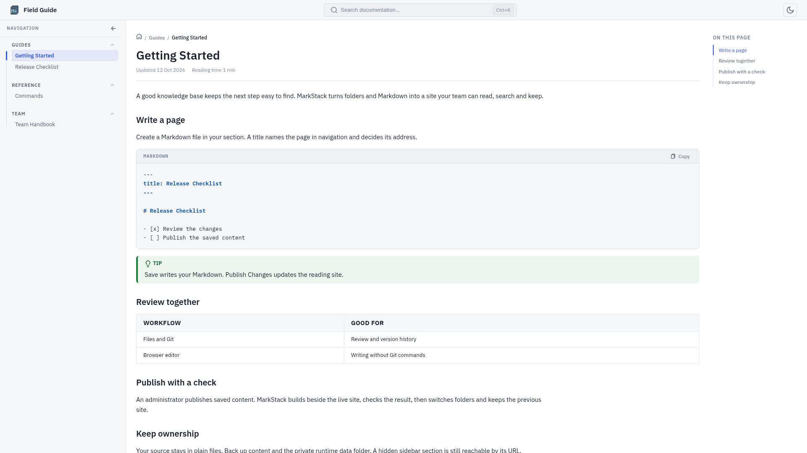

*Screenshots use a synthetic "Field Guide" site, fictional accounts and example domains.*

## Contents

- [Designed for a potato](#designed-for-a-potato)
- [What is included](#what-is-included)
- [Quick start](#quick-start)
- [How the pieces fit](#how-the-pieces-fit)
- [Writing content](#writing-content)
- [The reading site](#the-reading-site)
- [The browser editor](#the-browser-editor)
- [The Admin console](#the-admin-console)
- [Save, publish and Git](#save-publish-and-git)
- [Security](#security)
- [Hosting](#hosting)
- [Commands](#commands)
- [Troubleshooting and limits](#troubleshooting-and-limits)
- [Documentation map](#documentation-map)

## What is included

Built for documentation, handbooks, runbooks and team knowledge bases. The reader is static; the writing tools are optional.

| Part | What it does |
| --- | --- |
| Generator | Reads Markdown and writes a portable `dist/` folder |
| Reader | Navigation, search, themes, code copying and diagrams |
| Editor | Markdown source, live preview and local draft recovery |
| Admin | Accounts, sections, pages, branding and links |
| Publisher | Builds beside the live folder, checks it, then switches |

No proprietary content format. Skip the editor, keep your files in Git and build in CI, or run the editor privately for browser-based contributors. Saving never commits or pushes to Git for you.

## Quick start

Install Node.js 24+ and npm, then:

```bash
git clone https://github.com/KineticEnforcer/MarkStackV2.git
cd MarkStackV2
npm ci
npm run build
npm run serve
```

Open the address printed by `serve`. Any static server can serve `dist/` instead.

| To change | Edit |
| --- | --- |
| Home content | `content/_index.md` |
| Your pages | Markdown under `content/` |
| Site identity | `siteconfig.json` |
| Images | `static/images/` |
| Logo | `static/svg/logo.svg` |

### Optional browser editor

```bash
npm run editor:create-admin -- --user admin
npm run editor
```

The command asks for a password at a hidden prompt. Open `http://127.0.0.1:3001` and sign in. The editor listens on this computer only by default. For a team, see the [team server guide](content/build-deploy/team-server-setup.md).

## How the pieces fit

```text
content/ + static/ + templates/ + siteconfig.json
                       |
                   build.js
                       |
                     dist/
                       |
            static web host -> readers

browser editor -> saved Markdown -> Publish Changes -> dist/
```

Edit the source, never the generated HTML. The public host needs no Node server. Publishing updates the local `dist/` folder; getting it to a remote host is a separate step.

## Writing content

```text
content/
├── _index.md          Home page
├── guides/
│   ├── _index.md      Section page
│   └── quickstart.md  A normal page
└── .drafts/           Leading dot: not built
```

Each folder is a section and each `.md` file is a page. A page starts with a small YAML header:

```markdown
---
title: "Setup: Linux"
description: Install and verify the tools.
updated: 2026-10-12
---

Your page content.
```

The page title also becomes its web address, so renaming a title can break links. If two pages end up with the same address, the build stops instead of overwriting one. See the [content model](content/authoring/content-model.md), [frontmatter](content/authoring/frontmatter.md) and [media and links](content/authoring/media-and-links.md) guides.

## The reading site

| Feature | What readers get |
| --- | --- |
| Navigation | Nested sidebar, breadcrumbs, previous/next |
| Search | Page and heading results, runs in the browser |
| Themes | Light and dark, remembered per browser |
| Code and tables | Syntax highlighting, copy buttons |
| Diagrams | Mermaid diagrams in the browser |
| Phones | Responsive layout |

<details>
<summary>Dark theme and search screenshots</summary>

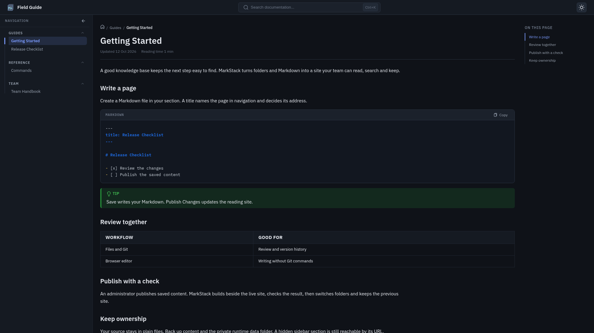

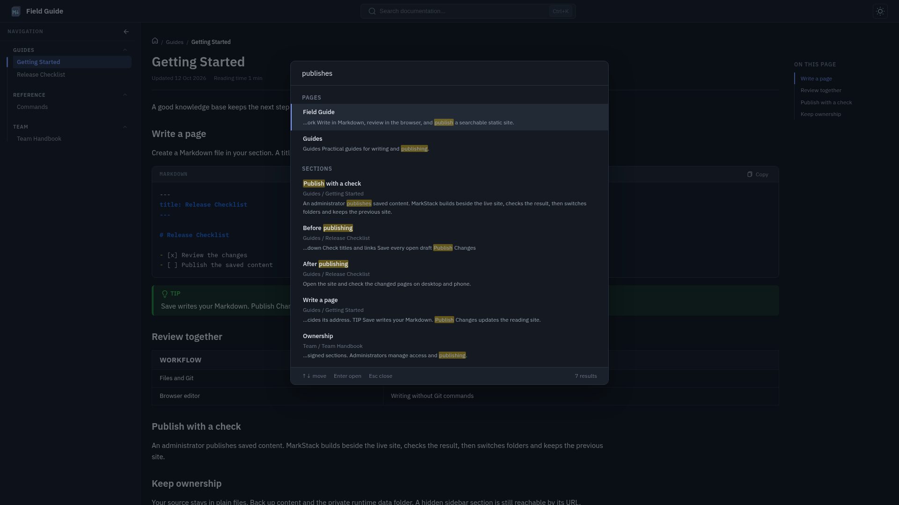

</details>

## The browser editor

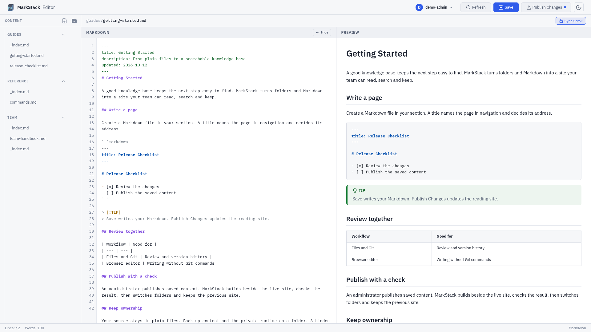

| Tool | What it does |
| --- | --- |
| File tree | Browse, create, rename and delete pages |
| Live preview | Source on one side, rendered page on the other |
| Save | Writes the file on the editor server |
| Drafts | Unsaved text is kept in your browser |
| Publish | Administrators rebuild the live site |
| Phones | Drawer navigation and Edit/Preview views |

Browser drafts are a convenience, not a backup. The editor is not a live collaboration tool or a Git history viewer.

## The Admin console

Administrators open it from the account menu. Editors never see it.

| Role | Can do |
| --- | --- |
| Administrator | All content, accounts, settings and publishing |
| Editor | Edit assigned sections and change their own password |

Admins manage users, sections, pages, site settings, header links, security status, publish history and an activity log. Accounts use usernames, not required email addresses. Details are in the [users and roles](content/editing-and-admin/users-and-roles.md) and [system](content/editing-and-admin/system.md) guides.

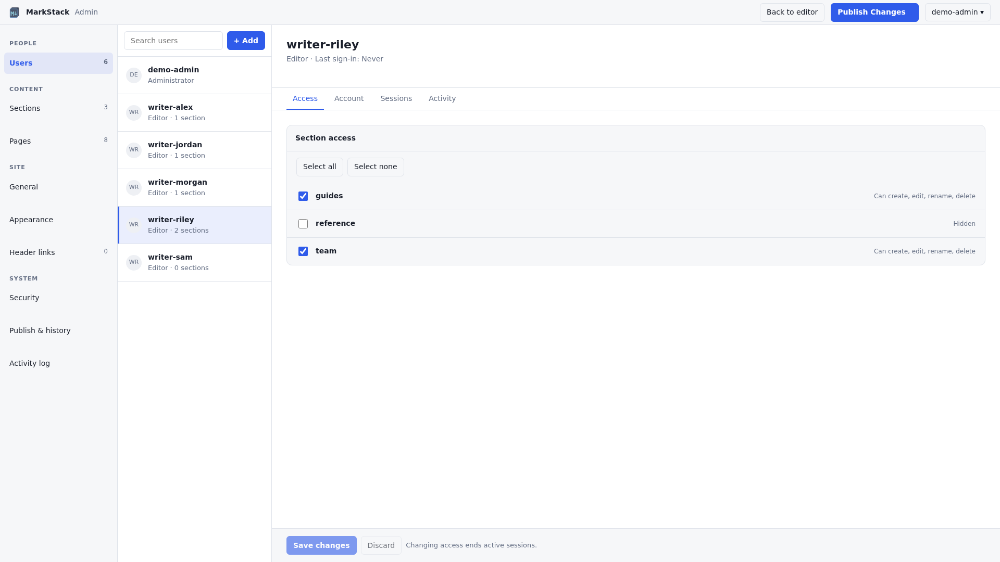

<details>
<summary>More Admin console screenshots</summary>

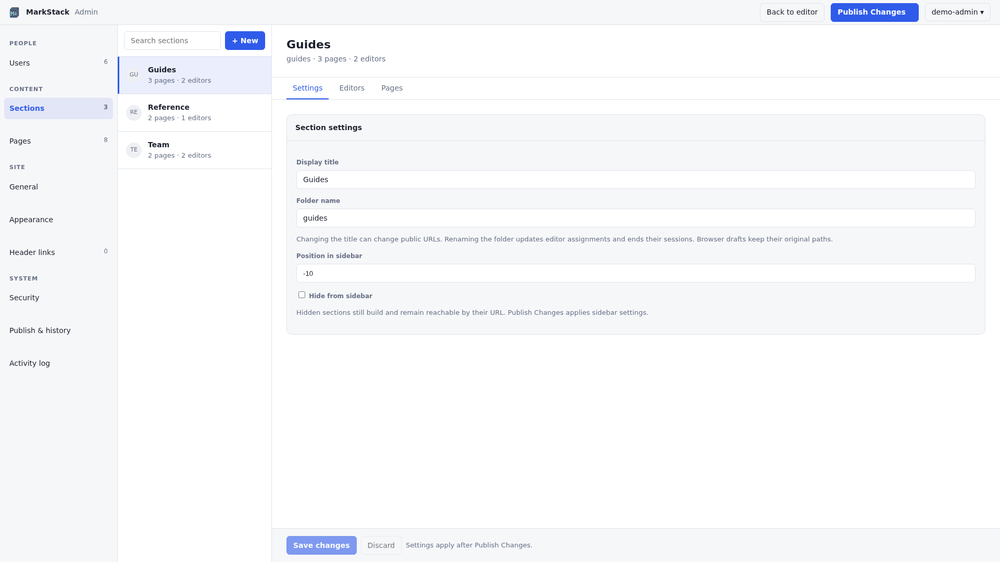

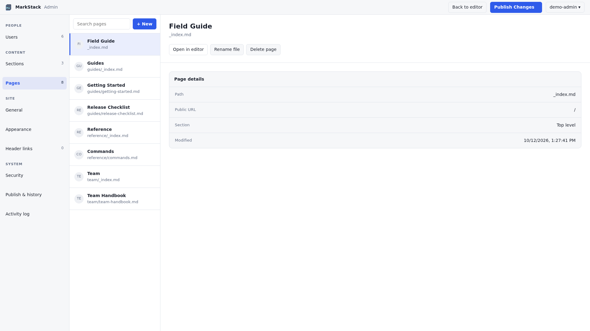

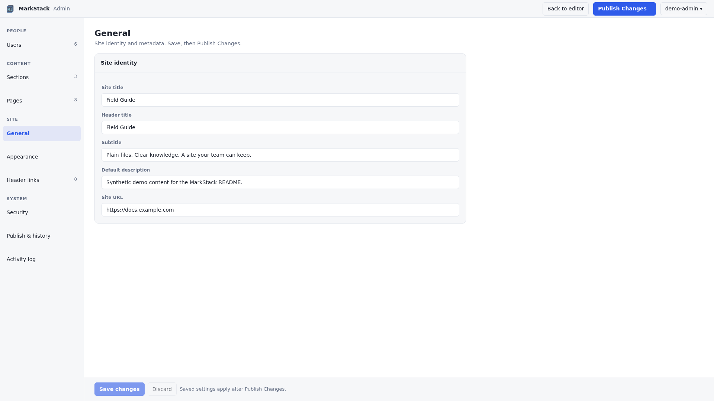

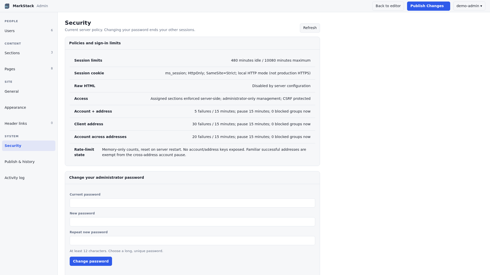

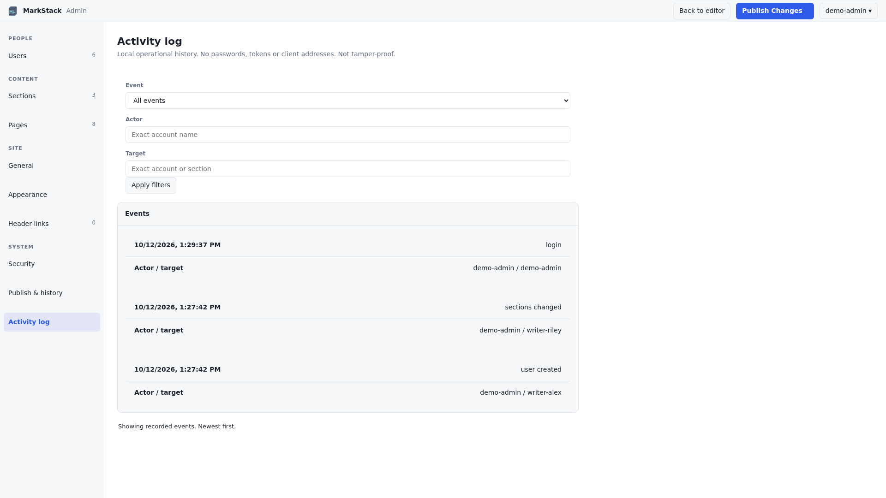

</details>

## Save, publish and Git

| Action | Effect |
| --- | --- |
| Keep draft | Unsaved text stays in this browser |
| Save | Writes Markdown or settings on the editor server |
| Publish Changes | Builds all saved content into local `dist/` |
| Git commit/push | Separate; your own versioning workflow |
| Remote deployment | Separate; your own upload or hosting pipeline |

**Publish includes every saved page, including other editors' changes.** Unsaved tabs and drafts are left out. If a build fails, the live site stays as it was. The button does not commit, push or upload anywhere.

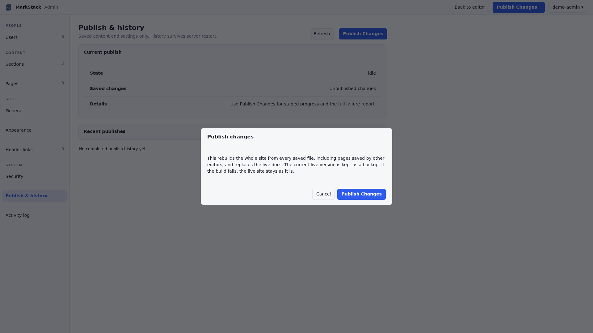

<details>
<summary>Publish history</summary>

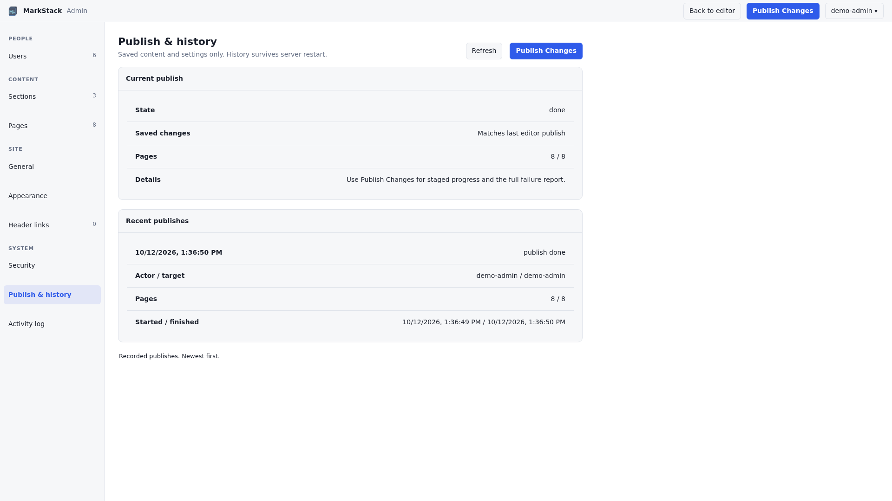

</details>

## Security

| Protection | Detail |
| --- | --- |
| Passwords | Salted hashes, 12 characters minimum |
| Sessions | Expire on timeout, account changes or restart |
| Writes | Cross-site request checks |
| Files | Editor can only touch allowed Markdown files |
| Access | Roles and sections enforced on the server |
| Raw HTML | Off unless the server file enables it |

Not built in: HTTPS, multi-factor sign-in, single sign-on or reader login. Put the editor behind an HTTPS proxy, and use host or network authentication if readers must sign in. Full details are in the [security guide](content/editing-and-admin/security.md).

## Hosting

```bash
npm ci
npm run build
# Deliver the CONTENTS of dist/ to the static host.
```

| Host | What you need |
| --- | --- |
| nginx, Caddy, Apache | Document root set to `dist/` |
| Static platform | Build `npm ci && npm run build`, output `dist` |
| Storage or CDN | Upload the files; set up clean URLs and a 404 page |
| Private readers | Host or network authentication |

For a team editor, keep the code, the built site and the private data in separate folders, run it as a low-privilege user and put HTTPS in front. See the [team server guide](content/build-deploy/team-server-setup.md) and the [hosting guide](content/build-deploy/deployment.md). Back up `content/` and the private data folder; the built `dist/` can always be rebuilt.

## Commands

| Command | Result |
| --- | --- |
| `npm ci` | Install the locked dependencies |
| `npm run build` | Build the site into `dist/` |
| `npm run serve` | Preview `dist/` locally |
| `npm run editor` | Start the browser editor |
| `npm test` | Run the test suite |

**The build clears its output folder.** Never point `--out` at source files or data you need. To contribute, see [CONTRIBUTING.md](CONTRIBUTING.md).

## Troubleshooting and limits

| Symptom | Check |
| --- | --- |
| YAML error | Quote colons and special characters |
| Duplicate URL | Two pages or folders with the same title |
| Saved but not live | Run Publish Changes, then deploy remotely |
| Missing image | Put it in `static/images/` and use `/images/name.png` |
| Section missing | Leading dot or hidden flag |

| Not built in | Use instead |
| --- | --- |
| Private reader sections | Host access control |
| Revision history and undo | Git and backups |
| Live collaboration | A review workflow |
| Image uploads | Add files under `static/` |

More in the [common issues](content/troubleshooting/common-issues.md) and [FAQ](content/troubleshooting/faq.md).

## Documentation map

Build the `content/` folder to read the guides through MarkStack, or open the source files below.

| Section | Guides |
| --- | --- |
| Getting started | [Installation](content/getting-started/installation.md), [quickstart](content/getting-started/quickstart.md), [structure](content/getting-started/project-structure.md), [editor setup](content/getting-started/set-up-the-editor.md) |
| Authoring | [Model](content/authoring/content-model.md), [frontmatter](content/authoring/frontmatter.md), [Markdown](content/authoring/markdown-features.md), [media](content/authoring/media-and-links.md), [examples](content/authoring/examples.md) |
| Editing/Admin | [Editor](content/editing-and-admin/visual-editor.md), [users](content/editing-and-admin/users-and-roles.md), [sections/pages](content/editing-and-admin/sections-and-pages.md), [settings](content/editing-and-admin/site-settings.md), [links](content/editing-and-admin/header-links.md), [publish](content/editing-and-admin/publishing.md), [security](content/editing-and-admin/security.md), [system](content/editing-and-admin/system.md) |
| Configuration | [Site](content/configuration/site-config.md), [home](content/configuration/homepage-content.md) |
| Build/deploy | [Commands](content/build-deploy/commands.md), [hosting](content/build-deploy/deployment.md), [CI](content/build-deploy/automated-builds.md), [team server](content/build-deploy/team-server-setup.md) |
| Customization | [Styling](content/customization/themes-and-styling.md), [templates](content/customization/templates.md) |
| Architecture | [Pipeline](content/architecture/build-pipeline.md), [navigation](content/architecture/navigation-and-routing.md), [search](content/architecture/search-and-indexing.md) |
| Troubleshooting | [Issues](content/troubleshooting/common-issues.md), [FAQ](content/troubleshooting/faq.md) |

## License and author

Created by **KineticEnforcer**. Licensed under [GPL-3.0](LICENSE); read the terms before redistributing or modifying. No commercial hosting service is required.
