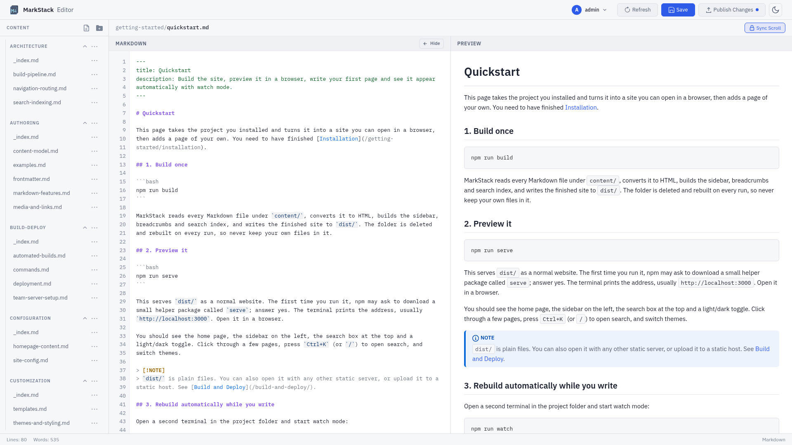

<p align="center">
  
</p>

<h1 align="center">MarkStack</h1>

<p align="center">
  <strong>A lightweight static site generator for markdown-based knowledge bases and documentation.</strong>
</p>

<p align="center">
  Transform your markdown files into a searchable, professional documentation website with minimal resource overhead.
</p>

<p align="center">
  <a href="#features">Features</a> |
  <a href="#why-markstack">Why MarkStack</a> |
  <a href="#use-cases">Use Cases</a> |
  <a href="#quick-start">Quick Start</a> |
  <a href="#documentation">Documentation</a> |
  <a href="#deployment">Deployment</a> |
  <a href="#license">License</a>
</p>

<p align="center">
  
  
</p>

---

## Design Philosophy

MarkStack is built on a simple premise: **Documentation should be accessible, robust, and permanent.** It is designed to serve all walks of life, from the student building a second brain, to the Dungeon Master organizing a campaign, to the Enterprise Architect enforcing ISO compliance.

**Built for the "Potato" & the Cloud**
I intentionally developed MarkStack on a single-core, 1GB RAM virtual machine. Why? Because if it runs there, it runs *anywhere*.
* **For the Hobbyist:** Run it on a Raspberry Pi Zero 2 W, an old laptop, or a free cloud tier. It respects your hardware.
* **For the Enterprise:** It scales effortlessly in high-availability clusters with zero resource bloat.

**Radical Simplicity: Vanilla by Design**
Modern web development has become over-complicated. MarkStack rejects this. MarkStack is built with **Vanilla JavaScript** and a single file build process. There is no complex architecture to learn, no "magic" black-box frameworks, and no fragility.
* **Hackable:** Because the code is simple and transparent, you can read it, understand it, and modify it to fit your exact needs.
* **Future-Proof:** With no heavy dependencies, your documentation site won't break just because an npm package updated 5 years from now.

**Enterprise Grade: Compliance & Audit**
In professional environments, documentation is a legal record. MarkStack solves "documentation rot" by treating your docs *as code*.
* **The Audit Trail:** You get an immutable Git history for every comma changed. Strict Pull Request workflows mean nothing goes live without approval. This is perfect for ISO record-keeping.
* **Accountability:** No more "mystery edits." You know exactly who wrote that API guide, who approved it, and when it went live.

**The "Headless" Brain: From D&D to Ph.D.**
You don't need to be a systems engineer to have a powerful, globally accessible knowledge base. MarkStack turns GitHub (or any private Git repo) into your personal Content Management System.
* **The Workflow:** Creating a study guide for a new subject? Managing lore for your D&D campaign? Just edit your files in the browser on GitHub (even on mobile!) and your site updates automatically if you setup the workflow, or if you have a site you use Cloudflare Pages or GitHub Pages with, it updated with each update to the repo!
* **The Freedom:** You get the ease of a note-taking app with the power of a static site. Your data remains yours. It is private, portable, and secure, stored in simple Markdown files that you will always own.

**OFF LINE MODE!**
* **Take it with you:** You can just clone the repo, build your first few pages and copy it to a USB, take it with you and use any text editor on any computer to edit the .md files! I REALLY recommend Caddy, it has a portable version for every OS, be it MacOS or Linux or Windows so basically all you have to do is just copy the the executable / binary to the dist folder and run it after you ran the script to build your files.
You can find it here: [Caddy Offical Repo](https://github.com/caddyserver/caddy/releases)

---

---

## Why MarkStack

- **The folder tree is the site.** Put Markdown in folders and the sidebar, URLs, breadcrumbs, previous and next links and the "On this page" list are generated. There is no menu file to keep in sync.
- **Search that needs no service.** Typo tolerant, supports `"exact phrases"`, and results open the page at the matching heading. It runs in the browser from one JSON file.
- **An editor for people who do not use Git.** Live preview with the real site stylesheet, accounts for administrators and editors, editors limited to the sections you give them, and a Publish Changes button that builds beside the live site, checks the result, switches it in and keeps the previous version.
- **Static output.** The result is plain HTML, CSS and JavaScript. Host it anywhere, with nothing running for your readers.
- **Small enough to read.** One build script, one template, one stylesheet, a short dependency list. You can change what you do not like.
- **Honest limits.** One template, alphabetical sidebar order, no plugins, no built-in translations and no comments. See the [FAQ](content/troubleshooting/faq.md).



---

## Use Cases

MarkStack adapts to a wide range of documentation needs. The table below outlines common scenarios where teams and individuals have successfully deployed MarkStack-powered sites.

| Use Case | Description | Example |
|----------|-------------|---------|
| **Product Documentation** | Public-facing documentation for software products, APIs, or services. Supports versioning through Git branches and provides professional presentation for end users. | SaaS product help center, open source project documentation |
| **Internal Knowledge Base** | Centralized repository for company policies, procedures, and institutional knowledge. Searchable and accessible to all team members without external dependencies. | IT runbooks, HR policies, operational procedures |
| **Developer Handbook** | Onboarding resource for new developers joining a team. Documents codebase architecture, development workflows, coding standards, and deployment processes. | Engineering team onboarding, contributor guidelines |
| **API Reference** | Technical reference documentation with code examples, endpoint descriptions, and authentication guides. Syntax highlighting supports 190+ languages. | REST API documentation, SDK reference |
| **Personal Knowledge Base** | Private or public collection of notes, tutorials, and reference material. Ideal for developers maintaining their own technical notes. | Learning notes, technology comparisons, how-to guides |
| **Course Material** | Educational content with structured navigation, code examples, and progressive learning paths. Task lists enable progress tracking for students. | Programming tutorials, certification study guides |
| **Project Wiki** | Lightweight alternative to traditional wiki software. Version-controlled through Git with full change history and collaborative editing through pull requests. | Team project documentation, research notes |

---

---

## GitHub-Native Workflow

MarkStack uses standard GitHub-flavored Markdown for all content. This design decision enables a streamlined documentation workflow that integrates directly with your existing development process.

**How it works:**

1. Documentation lives alongside your code in the same repository
2. Edit any `.md` file directly in the GitHub web interface or your local editor
3. Commit and push changes through your normal Git workflow
4. Rebuild the site with a single command
5. All changes are tracked in Git history with full attribution

This approach eliminates the need for separate documentation platforms or content management systems. Your documentation benefits from the same review process, branching strategy, and collaboration tools you already use for code. Pull requests enable documentation reviews, and merge conflicts are resolved using familiar Git workflows.

```bash
# Update documentation from the latest changes
git pull origin main
npm run build

# Documentation is now current
```

---

---

## Features

### Content Authoring

- **Standard Markdown** with YAML frontmatter, compatible with GitHub rendering
- **GitHub-style alerts** for NOTE, TIP, IMPORTANT, WARNING, and CAUTION callouts
- **Task lists and footnotes** for checklists and references
- **Syntax highlighting** for 190+ languages via highlight.js, with a language label and a Copy button on every code block
- **Mermaid diagrams** for flowcharts, sequence diagrams and more (loaded from a CDN, see [Security](content/editing-and-admin/security.md))
- **Titles decide URLs.** Rename a title and the address follows. Duplicate addresses fail the build and name both pages.

### Visual Editor

- File tree, Markdown source and live preview with scroll sync, a Hide button for the source pane, and a mobile layout with a file drawer and an Edit and Preview switch
- New files and folders can be placed in any folder at any depth with the Location drop-down
- Accounts with two roles. Editors only see and change the sections assigned to them
- **Publish Changes** (administrators) rebuilds the whole site beside the live one, checks it, switches it in only if the build succeeded, and shows live progress and a copyable error report if it fails
- Header links managed by an administrator, with favicons fetched safely by the server

### Reading Experience

- Dark and light themes, remembered per browser, applied before the page paints
- IBM Plex typography
- Responsive layout for desktop, tablet and phone
- Collapsible sidebar with a marker on the current page, breadcrumbs, reading time, an optional updated date, and previous and next links
- "On this page" list for pages with two or more `##` headings

### Search

- Press `Ctrl+K` (or `Cmd+K`, or `/`) or click the search box. Results are grouped into Pages and Sections with the folder path shown. Arrow keys move, Enter opens, Esc closes.
- Every typed word must match. Partial words match, small typos are tolerated for words of five or more letters, and quoted phrases must match exactly.
- Pages and their `##` to `####` headings are indexed. Code blocks are not.

### Output and Hosting

- Static HTML output that needs no application server
- Builds in well under a second for a few dozen pages
- Works on any static host or web server. See the [Deployment Guide](content/build-deploy/deployment.md)

---

## Quick Start

```bash
# Get the code from the address you received MarkStack from
git clone <repository-url> markstack
cd markstack

# Install dependencies
npm ci

# Build the site
npm run build

# Preview locally
npm run serve
```

Open the address that `npm run serve` prints (usually http://localhost:3000). The first run asks to download the `serve` package.

To write in the browser, create an administrator and start the editor:

```bash
npm run editor:create-admin -- --user admin
npm run editor
```

Then open http://127.0.0.1:3001 and sign in. See [Set Up the Editor](content/getting-started/set-up-the-editor.md).

---

## Documentation

The documentation is a MarkStack site built from the `content/` folder of this repository.

| Section | Description |
|---------|-------------|
| [Getting Started](content/getting-started/) | Requirements, installation, quick start, project structure, setting up the editor |
| [Authoring Content](content/authoring/) | The content model, frontmatter, Markdown features, media and links, examples |
| [Editing and Admin](content/editing-and-admin/) | The visual editor, users and roles, publishing, header links, security |
| [Configuration](content/configuration/) | Site settings and homepage content |
| [Customization](content/customization/) | Themes, styling, and the page template |
| [Build and Deploy](content/build-deploy/) | Commands, deployment, running the editor as a service, automated builds |
| [Architecture](content/architecture/) | Build pipeline, navigation and routing, search |
| [Troubleshooting](content/troubleshooting/) | Common issues and frequently asked questions |

---

## Project Structure

```text
markstack/
├── build.js              # The static site generator
├── editor-server.js      # Editor server
├── editor.html           # Editor page
├── login.html            # Sign-in page
├── admin-users.html      # User management page
├── admin-links.html      # Header links page
├── lib/                  # Accounts, sessions, section access, publishing, header links
├── scripts/              # create-admin and reset-admin commands
├── siteconfig.json       # Site settings
├── content/              # Your Markdown
│   ├── _index.md         # Home page content (optional)
│   └── section/          # A section is a folder
│       ├── _index.md     # The section's page and title
│       └── article.md
├── templates/
│   └── base.html         # The page template
├── static/               # Copied into the site as is
│   ├── css/  js/  svg/  images/
├── template/             # A small starter content folder to copy from
├── test/                 # Automated tests
└── dist/                 # Built site (git-ignored)
```

---

## Configuration

Edit `siteconfig.json`:

```json
{
  "siteTitle": "Acme Knowledge Base",
  "headerTitle": "Acme Docs",
  "siteSubtitle": "Guides and reference for Acme products.",
  "siteUrl": "https://docs.example.com",
  "baseUrl": "",
  "defaultDescription": "Documentation for Acme products",
  "showHero": true
}
```

| Property | Description |
|----------|-------------|
| `siteTitle` | The large heading in the home page hero |
| `headerTitle` | The name beside the logo and at the end of every page title |
| `siteSubtitle` | The line under the hero heading |
| `siteUrl` | Public address of the site, used in link previews |
| `baseUrl` | Path prefix for the template's links when the site is in a sub-folder, such as `/docs`. Leave empty for a root domain |
| `defaultDescription` | Description for pages that have none |
| `showHero` | Show or hide the home page hero |
| `copyrightText` | Available as `{{copyrightText}}` in a custom template. The default template has no footer |
| `allowRawHtml` | Optional. Set to `true` to render raw HTML in Markdown. Off by default, and only for sites where every author is trusted |

Links and images you write inside Markdown are not changed by `baseUrl`. Include the prefix yourself. More in [Site Config](content/configuration/site-config.md).

---

## Writing Content

```bash
mkdir content/tutorials
cat > content/tutorials/_index.md << 'EOF'
---
title: Tutorials
description: Step-by-step guides for common tasks.
---
EOF

cat > content/tutorials/first-steps.md << 'EOF'
---
title: First Steps
description: Your first tutorial.
updated: 2026-03-05
---

# First Steps

> [!TIP]
> Titles decide URLs. This page is served at `/tutorials/first-steps`.
EOF

npm run build
```

Only `title`, `description` and `updated` (or `date`) are read from the frontmatter. Quote a title that contains a colon and a space. See [Frontmatter](content/authoring/frontmatter.md) and [Markdown Features](content/authoring/markdown-features.md).

---

## Commands

| Command | Description |
|---------|-------------|
| `npm run build` | Build the site into `dist/` |
| `npm run watch` | Rebuild when files in `content/`, `static/` or `templates/` change |
| `npm run serve` | Preview `dist/` locally |
| `npm run clean` | Remove `dist/` |
| `npm run editor` | Start the visual editor (sign-in required) |
| `npm run editor:create-admin -- --user NAME` | Create an administrator (password at a hidden prompt) |
| `npm run editor:reset-admin -- --user NAME` | Set a new password for an administrator |
| `npm test` | Run the automated tests |

```bash
# Terminal 1: rebuild on change
npm run watch

# Terminal 2: serve the site
npm run serve
```

All options and environment variables are in the [Commands Reference](content/build-deploy/commands.md).

---

## Deployment

The output of `npm run build` is the `dist/` folder, and it can be served by any web server or static host.

| Where | Setup |
|-------|-------|
| Static hosting service that builds from Git | Build command `npm run build`, output folder `dist`, Node.js 24 or newer |
| Direct upload | Upload the contents of `dist/` |
| Your own server | Point nginx, Caddy or similar at `dist/` |

See the [Deployment Guide](content/build-deploy/deployment.md), [Team Server Setup](content/build-deploy/team-server-setup.md) for running the editor on a server, and [Automated Builds](content/build-deploy/automated-builds.md).

---

## Editor Security

The editor requires sign-in and listens on `127.0.0.1` by default. Passwords are stored as salted scrypt hashes, sessions use HttpOnly, SameSite=Strict cookies and CSRF tokens, failed sign-ins are rate limited, and editors reach only their assigned sections. Run it behind HTTPS if you expose it. Two-factor sign-in is not included.

The full list of protections, the environment variables and what browsers load from third parties are in [Security](content/editing-and-admin/security.md).

---

## Technology

| Component | Implementation |
|-----------|----------------|
| Markdown | [markdown-it](https://github.com/markdown-it/markdown-it) with anchor, footnote and task list plugins |
| Frontmatter | [gray-matter](https://github.com/jonschlinkert/gray-matter) and [js-yaml](https://github.com/nodeca/js-yaml), YAML only |
| Code highlighting | [highlight.js](https://highlightjs.org/) |
| Diagrams | [Mermaid](https://mermaid.js.org/), loaded in the browser |
| File watching | [chokidar](https://github.com/paulmillr/chokidar) for watch mode |
| Front end | Vanilla JavaScript, no framework |
| Typography | IBM Plex Sans and IBM Plex Mono |

---

## Requirements

- Node.js 24 or newer
- npm, which comes with Node.js

---

## Tests and CI

`npm test` runs the automated tests. GitHub Actions runs the tests, the build and `npm audit --audit-level=high` on Node.js 24 for pull requests and pushes to main that touch code, content, templates, static files, tests, package files or the workflow.

## License

This project is licensed under the GPL-3.0 license. See [LICENSE](LICENSE) for the full license text.

---

<p align="center">
  <sub>Built for people who value simplicity and performance.</sub>
</p>
