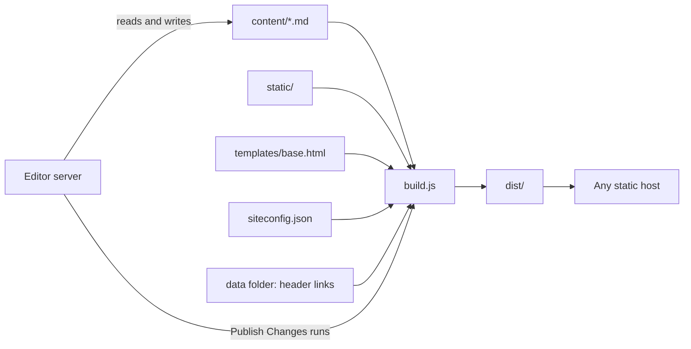

# Architecture

MarkStack is small on purpose. It is a Node.js build script, one HTML template, one stylesheet, a few browser scripts and an optional editor server. You can read all of it in an afternoon.

| Page | What it covers |
|------|----------------|
| [Build Pipeline](/architecture/build-pipeline/) | What the build does, in order |
| [Navigation and Routing](/architecture/navigation-and-routing/) | How URLs, the sidebar, breadcrumbs and previous and next links are produced |
| [Search and Indexing](/architecture/search-and-indexing/) | How search works in the browser without a server |

## Design choices

- **Files are the database.** Your content is plain Markdown in folders. There is nothing to migrate and nothing locked in.
- **Output is static.** The built site is HTML, CSS, JavaScript and one JSON file. Any host can serve it, and there is no server to patch.
- **Everything is built ahead of time.** Navigation, breadcrumbs, the table of contents and the search index are produced at build time. Readers' browsers only run the search and the theme switch.
- **A small dependency list.** The build uses `markdown-it` and a few plugins, `gray-matter` and `js-yaml` for frontmatter, `highlight.js` for code, and `chokidar` for watch mode.
- **The editor is separate.** Building never needs it, and it never serves your readers.

## The pieces

| File or folder | Role |
|----------------|------|
| `build.js` | The whole site generator |
| `editor-server.js`, `editor.html`, `login.html`, `admin-*.html` | The editor server and its pages |
| `lib/` | Editor parts: accounts, sessions, section access, publishing, header links |
| `templates/base.html` | The page template |
| `static/` | CSS, JavaScript, logo and images copied into the site |
| `content/` | Your pages |
| `siteconfig.json` | Site settings |
| `test/` | Automated tests |

## Limits worth knowing

- Every build renders every page. This takes well under a second for a few dozen pages, and grows with the page count.
- Navigation order is alphabetical by title, with folders first. There is no manual ordering setting.
- Search is client side. The index file is downloaded the first time someone searches, so very large sites send a larger file. See [Search and Indexing](/architecture/search-and-indexing/).
