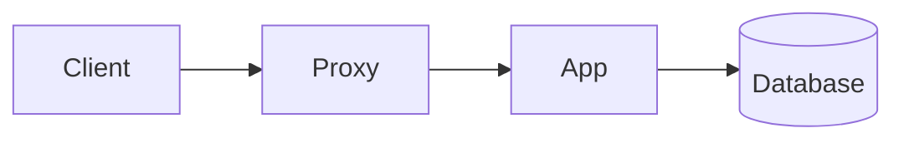

# Examples

Copy any of these into `content/` and run `npm run build`.

## A small product knowledge base

```text
content/
  _index.md
  getting-started/
    _index.md
    installation.md
    first-steps.md
  guides/
    _index.md
    importing-data.md
    team-permissions.md
  reference/
    _index.md
    api-overview.md
    error-codes.md
```

The URLs depend on the titles, not the file names. A page titled "Importing Data" inside a folder whose `_index.md` is titled "Guides" is served at `/guides/importing-data/`.

## A section landing page

`content/guides/_index.md`:

```markdown
---
title: Guides
description: Step-by-step walkthroughs for common tasks.
---

# Guides

Pick the task you want to finish. Each guide ends with a short checklist.
```

The sidebar lists the pages of the folder under this title.

## A how-to page

````markdown
---
title: Importing Data
description: Load a CSV file into a new project.
updated: 2026-03-05
---

# Importing Data

You need a CSV file with a header row.

## Prepare the file

1. Save the file as UTF-8.
2. Remove empty rows.

## Run the import

```bash
my-tool import ./customers.csv
```

> [!TIP]
> Run the import on a copy of your data first.

## Check the result

| Check | Expected |
|-------|----------|
| Row count | Same as the file |
| Errors | None |
````

The `updated` date is shown on the page. Headings written as `##` appear in the table of contents on the right when a page has at least two of them.

## A page with a diagram

````markdown
---
title: Request Flow
description: How a request moves through the system.
---

# Request Flow


````

Diagrams are drawn in the reader's browser. See [Markdown Features](/authoring-content/markdown-features/) for details and limits.

## A title with a colon

Titles that contain a colon and a space must be quoted, or the build stops with a YAML error.

```markdown
---
title: "Setup: first steps"
---
```

## A hidden notes file

Anything that starts with a dot is skipped by the build.

```text
content/guides/.todo.md
```
