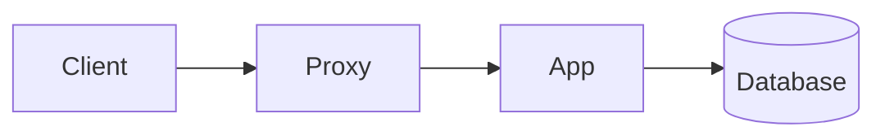
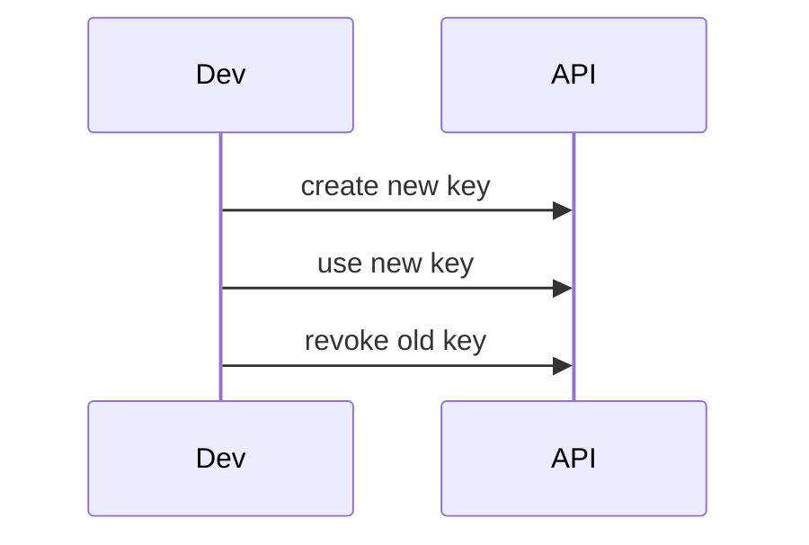

# Examples

Copy any of these into `content/` and run `npm run build`.

## A small product knowledge base

```text
content/
  _index.md
  getting-started/
    _index.md
    installation.md
    first-steps.md
  guides/
    _index.md
    importing-data.md
    team-permissions.md
  reference/
    _index.md
    api-overview.md
    error-codes.md
```

The URLs depend on the titles, not the file names. A page titled "Importing Data" inside a folder whose `_index.md` is titled "Guides" is served at `/guides/importing-data/`.

## A section landing page

`content/guides/_index.md`:

```markdown
---
title: Guides
description: Step-by-step walkthroughs for common tasks.
---

# Guides

Pick the task you want to finish. Each guide ends with a short checklist.
```

The sidebar lists the pages of the folder under this title.

## A how-to page

````markdown
---
title: Importing Data
description: Load a CSV file into a new project.
updated: 2026-03-05
---

# Importing Data

You need a CSV file with a header row.

## Prepare the file

1. Save the file as UTF-8.
2. Remove empty rows.

## Run the import

```bash
my-tool import ./customers.csv
```

> [!TIP]
> Run the import on a copy of your data first.

## Check the result

| Check | Expected |
|-------|----------|
| Row count | Same as the file |
| Errors | None |
````

The `updated` date is shown on the page. Headings written as `##` appear in the table of contents on the right when a page has at least two of them.

## A page with a diagram

````markdown
---
title: Request Flow
description: How a request moves through the system.
---

# Request Flow


````

Diagrams are drawn in the reader's browser. See [Markdown Features](/authoring-content/markdown-features/) for details and limits.

## A title with a colon

Titles that contain a colon and a space must be quoted, or the build stops with a YAML error.

```markdown
---
title: "Setup: first steps"
---
```

## A hidden notes file

Anything that starts with a dot is skipped by the build.

```text
content/guides/.todo.md
```

## Worked scenario: from empty folder to a published site

This walk-through uses only commands that exist in the project. Run them in the project folder.

1. Install and check the project.

```bash
npm ci
npm test
```

2. Replace the sample content. Keep the folder `content/`, and delete what is inside it.

3. Create a home page, one section and one page.

```text
content/
  _index.md
  guides/
    _index.md
    first-guide.md
```

`content/_index.md`:

```markdown
---
title: Acme Help Center
description: Answers for customers and the support team.
---

# Acme Help Center

## Start here

Pick a guide from the sidebar, or press `Ctrl+K` to search.

## Need a person?

Write to the support team from the contact page.
```

4. Build and look at it.

```bash
npm run build
npm run serve
```

Open the address that `serve` prints. Edit a page, run `npm run build` again and refresh. To rebuild on every save, use `npm run watch` in one terminal and `npm run serve` in another.

5. Put `dist/` on any static host. See the [Deployment Guide](/build-and-deploy/deployment-guide/).

## Worked scenario: a handbook with two writers

Goal: the support team writes in `support/`, the product team writes in `product/`, and only you publish.

1. Create the folders `content/support/` and `content/product/`, each with an `_index.md`. Use lowercase names with no spaces, because section names must match `a-z`, `0-9`, dash and underscore.
2. Start the editor and create the first administrator.

```bash
npm run editor:create-admin -- --user admin
npm run editor
```

3. Sign in, open the account menu and choose **Users and sections**. Add one editor for each team and tick only that team's section.
4. Each editor now sees only their own section in the file tree. They can create, edit, rename and delete pages inside it. They cannot touch the other section, the home page or the section folders themselves, and they have no Publish Changes button.
5. As the administrator, open the editor, check the pages and press **Publish Changes**. The site is built in a separate folder, checked, and then switched in. See [Publishing](/editing-and-admin/publishing).

If you serve the editor to a team over a network, read [Team Server Setup](/build-and-deploy/team-server-setup) first.

## Worked scenario: a page that uses every common feature

````markdown
---
title: Rotate API Keys
description: Replace an API key without downtime.
updated: 2026-03-05
---

# Rotate API Keys

Rotate keys every 90 days, or at once if a key was shared by mistake.

## Before you start

- [x] You can sign in as an owner
- [ ] The new key is stored in your secret manager

## Steps

1. Create a new key.
2. Deploy it to one service.
3. Remove the old key.

```bash
my-tool keys create --name "ci-2026-03"
my-tool keys revoke --id OLD_KEY_ID
```

> [!WARNING]
> A revoked key stops working immediately.

## What happens during rotation



| Stage | Old key | New key |
|-------|---------|---------|
| Create | Works | Works |
| Switch | Works | Works |
| Revoke | Stops | Works |

Keys are checked on every request[^1].

[^1]: Cached checks last for up to a minute in this example.
````

This page uses frontmatter, a task list, an ordered list, code, an alert, a diagram, a table and a footnote. Each one is described on [Markdown Features](/authoring-content/markdown-features). The commands in the example belong to a made-up tool.

## Common mistakes and fixes

| You wrote | What happens | Fix |
|-----------|--------------|-----|
| `title: Setup: first steps` | The build stops with a YAML error | Quote it: `title: "Setup: first steps"` |
| Two pages with the same title in one folder | The build stops and names both pages | Change one title |
| A folder with no `_index.md` | The sidebar shows a link that goes nowhere | Add an `_index.md` with a title |
| A file starting with a dot | It is skipped on purpose | Rename it when it is ready |
| Raw HTML in a page | It is not rendered | Use Markdown instead |
