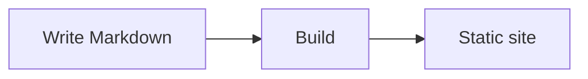

# Markdown Features

MarkStack uses the CommonMark flavor of Markdown with a few well-known additions. This page shows each feature as source followed by the result, so you can see both.

## Headings

```markdown
## A section
### A subsection
#### A smaller one
```

Use one `#` heading at the top of a page, then `##` for sections. Every heading gets an anchor: hover it and click the `#` that appears to copy a link to that spot. The anchor is the heading in lowercase with spaces and punctuation turned into dashes, so `## Getting started` links as `#getting-started`.

The right-hand **On this page** list shows the `##` headings. Search indexes `##`, `###` and `####` headings, so readers can jump straight to a subsection.

## Text

```markdown
Plain text, **bold**, *italic*, ***both***, ~~strikethrough~~ and `inline code`.

A line break needs a blank line between paragraphs.
```

Plain text, **bold**, *italic*, ***both***, ~~strikethrough~~ and `inline code`.

Typographic replacements are on. Straight quotes become "curly quotes", `--` becomes an en dash (1--10), `---` an em dash, `...` an ellipsis... and `(c)` becomes (c).

URLs written as plain text become links on their own: https://example.com.

## Lists

```markdown
- Bullet
- Another
  - Nested

1. First
2. Second
3. Third
```

- Bullet
- Another
  - Nested

1. First
2. Second
3. Third

### Task lists

```markdown
- [x] Done
- [ ] Still to do
```

- [x] Done
- [ ] Still to do

Task list boxes are display-only on the published site.

## Quotes

```markdown
> A quoted passage.
```

> A quoted passage.

## Alerts

Five kinds of highlighted boxes are available. Start a blockquote with a marker in capitals:

```markdown
> [!NOTE]
> Useful background information.

> [!TIP]
> A shortcut or better way.

> [!IMPORTANT]
> Something the reader must know.

> [!WARNING]
> Something that can cause problems.

> [!CAUTION]
> Something that can cause damage or data loss.
```

> [!NOTE]
> Useful background information.

> [!TIP]
> A shortcut or better way.

> [!IMPORTANT]
> Something the reader must know.

> [!WARNING]
> Something that can cause problems.

> [!CAUTION]
> Something that can cause damage or data loss.

Each box has its own icon and color, adjusted for the light and dark themes. Alerts can hold paragraphs, lists and code.

## Tables

```markdown
| Plan | Seats | Price |
| :--- | :---: | ---: |
| Free | 1 | $0 |
| Team | 10 | $20 |
```

| Plan | Seats | Price |
| :--- | :---: | ---: |
| Free | 1 | $0 |
| Team | 10 | $20 |

A colon in the divider row sets the alignment: left, center or right. Keep tables to a few short columns so they stay readable on phones.

## Code

Wrap code in three backticks and name the language after them:

````markdown
```javascript
function greet(name) {
  return `Hello, ${name}!`;
}
```
````

```javascript
function greet(name) {
  return `Hello, ${name}!`;
}
```

Highlighting is done at build time, so it works without JavaScript. Every block shows its language in a header with a **Copy** button. The colors follow the light and dark themes. Common languages work out of the box, including `bash`, `javascript`, `typescript`, `json`, `yaml`, `html`, `css`, `python`, `go`, `rust`, `java`, `sql`, `diff` and `markdown`. A block with an unknown or missing language is shown as plain monospaced text.

Long lines scroll sideways inside the block.

## Footnotes

```markdown
Static sites are fast.[^speed]

[^speed]: There is no server work for each visit, only files.
```

Static sites are fast.[^speed]

[^speed]: There is no server work for each visit, only files.

Footnotes are collected at the bottom of the page with a link back to the reference.

## Diagrams

Draw diagrams with [Mermaid](https://mermaid.js.org) in a code block marked `mermaid`:

````markdown

````


Flowcharts, sequence diagrams, state diagrams, Gantt charts and the other Mermaid types all work. Diagrams are drawn in the reader's browser and follow the theme. The Mermaid library is loaded from a public CDN, so a reader who is offline, or whose network blocks it, sees the diagram source as text instead. See [Security](/editing-and-admin/security) for what this means for strict content policies.

## Horizontal rules

A line with three dashes draws a divider:

```markdown
---
```

---

## Raw HTML

Raw HTML in Markdown is **off by default**. A tag such as `<div>` or `<script>` is shown as text, not run. This is a safety feature: anyone who can edit a page cannot add scripts to your site. A site owner can allow raw HTML by setting `"allowRawHtml": true` in `siteconfig.json`. That file lives on the server, and the editor cannot change it. See [Site Configuration](/configuration/site-config).

## What is not included

To set expectations: MarkStack has no built-in tabs, collapsible sections, math typesetting, or comment system. Mermaid, alerts, task lists and footnotes are the extended features. Anything beyond them needs raw HTML, if the site owner allows it.
