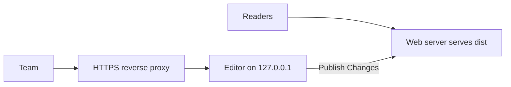

# Team Server Setup

This page shows one way to run the editor for a team on a Linux server with systemd. Every name, path and port below is a placeholder. Replace them with your own.

## What you are setting up



- The web server serves `dist/` to readers. See [Deployment Guide](/build-and-deploy/deployment-guide/).
- The editor listens on the loopback address only. A reverse proxy adds HTTPS and sends team traffic to it.
- Publish Changes replaces `dist/` in place, so the editor's user must be able to write to the folder that contains `dist/`.

## 1. Install

Use a dedicated system user and a folder for the project.

```bash
sudo useradd --system --create-home --home-dir /srv/knowledge-base --shell /usr/sbin/nologin kbeditor
sudo -u kbeditor git clone <repository-url> /srv/knowledge-base/app
cd /srv/knowledge-base/app
sudo -u kbeditor npm ci
```

`<repository-url>` is the address you got MarkStack from. Node.js 24 or newer must be installed.

Keep the accounts and header links outside the code folder, so updating the code never touches them.

```bash
sudo -u kbeditor mkdir -p /srv/knowledge-base/data
```

## 2. Create the first administrator

```bash
cd /srv/knowledge-base/app
sudo -u kbeditor env MARKSTACK_USERS_FILE=/srv/knowledge-base/data/users.json \
  npm run editor:create-admin -- --user admin
```

Type the password at the hidden prompt.

## 3. Run it with systemd

Create `/etc/systemd/system/kb-editor.service`:

```ini
[Unit]
Description=MarkStack editor
After=network.target

[Service]
User=kbeditor
WorkingDirectory=/srv/knowledge-base/app
ExecStart=/usr/bin/node editor-server.js
Environment=MARKSTACK_EDITOR_PORT=3001
Environment=MARKSTACK_EDITOR_HOST=127.0.0.1
Environment=MARKSTACK_USERS_FILE=/srv/knowledge-base/data/users.json
Environment=MARKSTACK_EDITOR_ALLOWED_HOSTS=docs-editor.example.com
Environment=MARKSTACK_EDITOR_COOKIE_SECURE=1
Environment=MARKSTACK_TRUSTED_PROXIES=loopback
Restart=on-failure
NoNewPrivileges=true
ProtectSystem=strict
ReadWritePaths=/srv/knowledge-base

[Install]
WantedBy=multi-user.target
```

Check the Node.js path with `which node`, then start it:

```bash
sudo systemctl daemon-reload
sudo systemctl enable --now kb-editor
sudo systemctl status kb-editor
```

What the settings do:

| Setting | Why |
|---------|-----|
| `MARKSTACK_EDITOR_HOST=127.0.0.1` | Only the proxy on the same machine can reach the editor |
| `MARKSTACK_EDITOR_ALLOWED_HOSTS` | The public host name of the editor, written exactly as browsers send it (with the port if it is not 80 or 443). Other `Host` headers are refused |
| `MARKSTACK_EDITOR_COOKIE_SECURE=1` | Sign-in cookie is only sent over HTTPS |
| `MARKSTACK_TRUSTED_PROXIES=loopback` | The editor trusts `X-Forwarded-For` from the local proxy, so sign-in limits apply per visitor |
| `ReadWritePaths` | With `ProtectSystem=strict` the editor can write only here. It must include the folders for `content/`, `dist/` and the data folder |

Publish creates its temporary folders next to `dist/`, so the folder that holds `dist/` has to be writable. If it is not, Publish stops at the first stage and the message says so.

## 4. Reverse proxy

nginx example:

```nginx
server {
    listen 443 ssl;
    server_name docs-editor.example.com;
    # ssl_certificate and ssl_certificate_key go here

    client_max_body_size 3m;

    location / {
        proxy_pass http://127.0.0.1:3001;
        proxy_set_header Host $host;
        proxy_set_header X-Forwarded-For $remote_addr;
        proxy_set_header X-Forwarded-Proto $scheme;
    }
}
```

Set `X-Forwarded-For` to the client address as above rather than appending to what the client sent, so a client cannot pick its own address.

## 5. Serve dist

Point your public web server at `/srv/knowledge-base/app/dist`. It does not need to be the same host name as the editor.

## Updating MarkStack

```bash
cd /srv/knowledge-base/app
sudo -u kbeditor git pull
sudo -u kbeditor npm ci
sudo systemctl restart kb-editor
```

Changes to the editor's server code need the restart. Restarting signs everyone out, because sessions are kept in memory. After an update, an administrator should run Publish Changes so the public site uses the new templates.

## Backups

Back up these before you change anything on the server:

- `content/`, unless it lives in Git
- the data folder: `users.json`, `links.json`, `favicons/`, `site-settings.json`, `audit.jsonl` and its rotated archives
- `siteconfig.json`, and `static/` or `templates/` if you changed them

`dist/` can always be rebuilt, and Publish keeps one previous copy as `dist.previous`.

## Checks

```bash
curl -I https://docs-editor.example.com/login
journalctl -u kb-editor -n 50
```

The login page should answer `200`. The log shows sign-ins, failures and publishes with the account name, never passwords.
